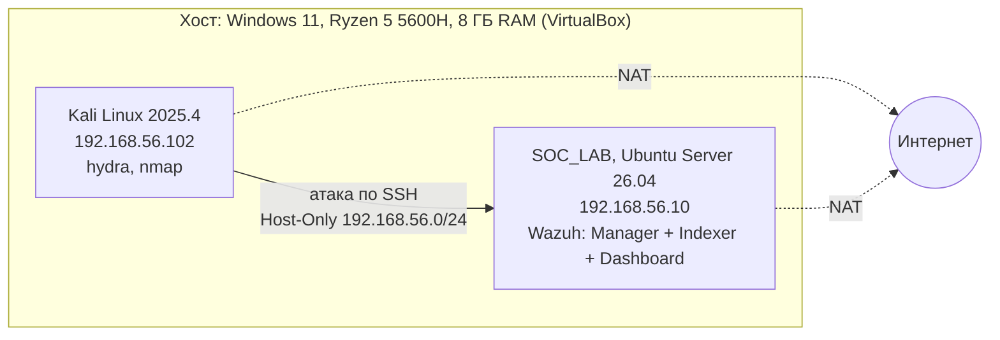
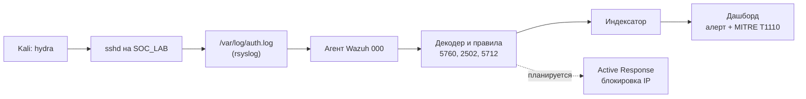

# SOC_LAB (brute force)

Домашний SOC-стенд на базе Wazuh. Здесь разобрана атака брутфорс SSH.

Учебная лаборатория, в которой я разбираюсь, как SIEM/XDR-платформа Wazuh
обнаруживает атаки. Всё развёрнуто в VirtualBox: одна машина атакует, вторая
собирает и анализирует события. Wazuh ловит атаку, привязывает её к матрице
MITRE ATT&CK и показывает алерт на дашборде.

Проект пока в работе. Готов один сценарий (брутфорс SSH), остальные ещё впереди.

---

## 1. Цель и задачи

Цель простая: собрать работающий стенд мониторинга и пройти на нём весь путь
«атака, обнаружение, реагирование» хотя бы на нескольких сценариях.

Что нужно сделать:
- развернуть Wazuh и подключить источники событий (готово);
- настроить сбор и разбор логов (готово);
- смоделировать типовые атаки: брутфорс, повышение привилегий, изменение файлов и другие (в процессе, сделан брутфорс);
- написать собственные правила корреляции (в процессе);
- настроить Active Response (пока не начато);
- оформить результаты: схемы, описания сценариев, скриншоты (в процессе).

---

## 2. Архитектура стенда

Схема сети стенда:



Путь события от атаки до алерта:



Как это работает:
1. Kali атакует SOC_LAB по сети Host-Only 192.168.56.0/24.
2. На SOC_LAB события попадают в системный лог (/var/log/auth.log, journald).
3. Локальный агент Wazuh (000) читает лог, декодер его разбирает, правила оценивают.
4. Алерт уходит в индексатор и появляется на дашборде вместе с техникой MITRE ATT&CK.
5. Дальше планируется Active Response, чтобы IP атакующего блокировался автоматически.

---

## 3. Компоненты стенда

| Машина | ОС / ПО | Версия | RAM / CPU | IP (Host-Only) | Роль |
|---|---|---|---|---|---|
| SOC_LAB | Ubuntu Server | 26.04.1 LTS | 4 ГБ / 2 | 192.168.56.10 | SIEM (Wazuh) |
| Wazuh | Manager + Indexer + Dashboard | 4.14.8 | — | — | сбор, анализ, визуализация |
| Kali | Kali Linux | 2025.4 | 2 ГБ / 2 | 192.168.56.102 | атакующая машина |

У обеих виртуалок по два адаптера: NAT для интернета и Host-Only
(VirtualBox Host-Only Ethernet Adapter, сеть 192.168.56.0/24), чтобы стенд
общался сам с собой и не выходил наружу.

---

## 4. Развёртывание

Что уже сделано, описано в [docs/deployment.md](docs/deployment.md). Полноценной
пошаговой инструкции пока нет, вот что в неё должно войти:

- [ ] установка Ubuntu Server и Wazuh (all-in-one);
- [ ] настройка сети Host-Only в VirtualBox;
- [ ] проверка портов (1514, 1515, 55000, 443, 9200);
- [ ] подключение Kali к сети стенда.

---

## 5. Настройка сбора логов

На Ubuntu 26.04 из коробки работает только journald, из-за этого события атак
доходили до Wazuh не все. Пришлось подкрутить несколько вещей:

| Изменение | Зачем | Где |
|---|---|---|
| Поставлен rsyslog, Wazuh читает /var/log/auth.log | чтобы сбор событий SSH не зависел от journald | ossec.conf |
| PerSourcePenalties no | новый штраф OpenSSH мешал повторять брутфорс-тесты | sshd_config.d/99-lab.conf |
| Снят rate-limit journald | чтобы не терять события при всплеске | journald.conf.d/ |

Подробности в [docs/log-collection.md](docs/log-collection.md).

---

## 6. Сценарии атак

Каждый сценарий описан по одной схеме: цель, шаги атаки, что сработало в Wazuh,
техника MITRE, скриншоты, реагирование.

| # | Сценарий | Инструмент | Правила Wazuh | MITRE | Статус |
|---|---|---|---|---|---|
| 1 | Брутфорс SSH | hydra | 5760 (сущ. юзер), 5712 (несущ.) | T1110 | готов |
| 2 | Создание пользователя / выдача sudo | adduser, usermod | — | T1136, T1548 | план |
| 4 | Изменение критичных файлов (FIM) | правка /etc | syscheck | T1565 | план |
| 5 | Сканирование портов | nmap | — | T1046 | план |
| 6 | Поиск уязвимостей (Vulnerability Detection) | встроенный модуль | — | — | план |
| 7 | Проверка конфигурации по CIS (SCA) | встроенный модуль | — | — | план |

У каждой атаки своя папка в scenarios/: разбор, runbook и скриншоты лежат вместе. Первый разбор: [scenarios/01-ssh-bruteforce](scenarios/01-ssh-bruteforce/README.md).

---

## 7. Правила обнаружения

Пока обходимся штатным набором правил Wazuh (в нём около 8500 правил),
собственные не добавлял.

Что сработало в сценарии 1:

| ID | Уровень | Описание | MITRE |
|---|---|---|---|
| 5760 | 5 | sshd: authentication failed, неудачный вход по SSH | T1110 |
| 2502 | 10 | syslog: User missed the password more than one time, повторные неудачи | T1110 |
| 5712 | 10 | sshd: brute force, перебор несуществующих пользователей | T1110 |

Брутфорс по существующему пользователю (nikolay) виден как серия событий 5760
плюс агрегирующее правило 2502. А вот 5712 заточено под перебор несуществующих
логинов (в логе «Invalid user»), так что здесь оно не срабатывает.

Файл rules/local_rules.xml пока пустой, это заготовка под свои правила
(диапазон ID от 100000).

---

## 8. Автоматическое реагирование (Active Response)

Пока не сделано. Задумка такая: блокировать IP атакующего через firewall-drop
при срабатывании 5712 и снимать блокировку по таймауту.

---

## 9. Структура репозитория

```
soc-lab/
├── README.md                    # обзор проекта
├── docs/
│   ├── deployment.md            # развёртывание стенда
│   ├── log-collection.md        # настройка сбора логов
│   └── screenshots/             # скриншоты настройки VirtualBox
├── scenarios/
│   ├── 01-ssh-bruteforce/       # атака 1: брутфорс SSH
│   │   ├── README.md            # разбор
│   │   ├── runbook.md           # порядок прогона
│   │   └── screenshots/
│   └── _template.md             # шаблон для следующих атак
├── rules/
│   └── local_rules.xml          # собственные правила (пока пусто)
└── configs/                     # конфиги стенда
```

В репозитории нет паролей и токенов. Если буду выкладывать конфиги, секреты в
них заменю, например на indexer_password: '<REDACTED>'.

---

## 10. Итоги

Развёрнута домашняя SOC-лаборатория на Wazuh, Kali и Ubuntu. Реализован один
сценарий атаки (брутфорс SSH, техника T1110), сбор логов адаптирован под
Ubuntu 26.04. Дальше в планах ещё несколько сценариев, свои правила корреляции,
мониторинг целостности файлов и Active Response.
