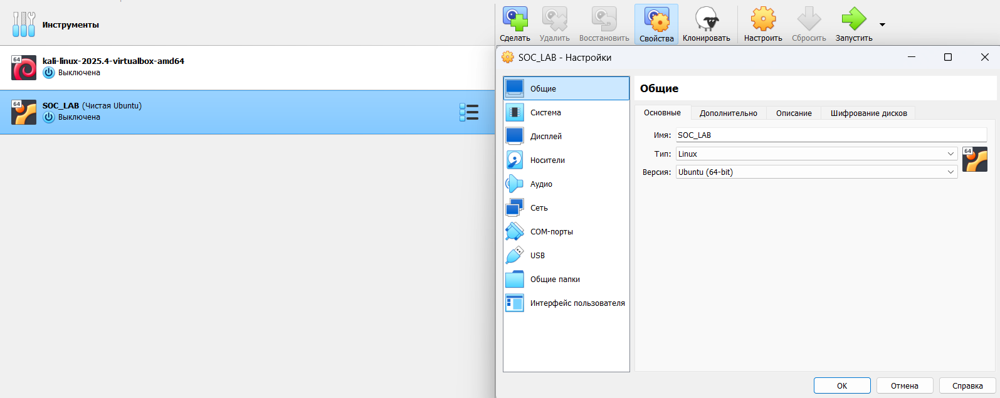
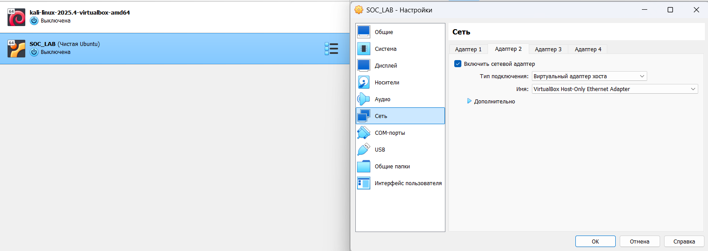
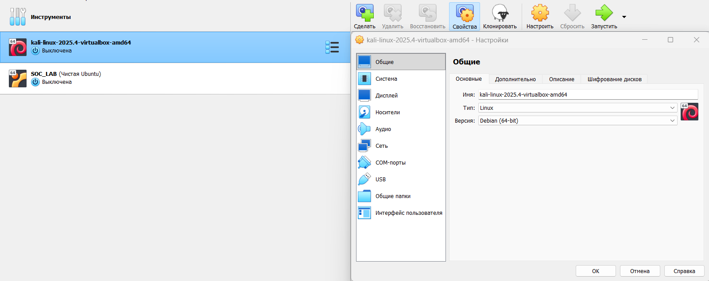
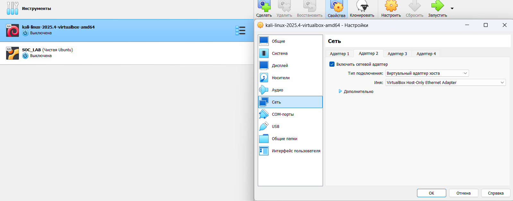
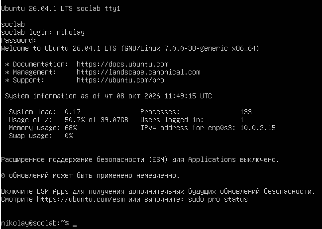

# Развёртывание стенда

Стенд построен на базе гипервизора VirtualBox и состоит из двух виртуальных машин:
сервера мониторинга с Wazuh и атакующей машины Kali Linux. Ниже описан порядок
развёртывания и настройки сети.

## 1. Хост и гипервизор
- Хост: Windows 11, AMD Ryzen 5 5600H, 8 ГБ RAM.
- Гипервизор: Oracle VirtualBox.

## 2. Сеть VirtualBox

Чтобы машины видели друг друга, но при этом были изолированы от внешней сети,
используется Host-Only сеть 192.168.56.0/24. У каждой машины по два адаптера:
первый — NAT (для доступа в интернет, обновления и установка пакетов), второй —
Host-Only (для взаимодействия внутри стенда).

### SOC_LAB (сервер Wazuh)

Рисунок 1 — Параметры виртуальной машины SOC_LAB

Машина создана как Ubuntu (64-bit). Второй сетевой адаптер переведён в режим
виртуального адаптера хоста.

Рисунок 2 — Настройка Host-Only адаптера сервера

### Kali Linux (атакующая машина)

Рисунок 3 — Параметры виртуальной машины Kali Linux

У Kali точно так же включён второй адаптер в ту же сеть Host-Only, что и у сервера.
Благодаря этому обе машины оказываются в одной подсети.

Рисунок 4 — Настройка Host-Only адаптера Kali

## 3. Сервер SOC_LAB

На сервере установлена Ubuntu Server 26.04.1 LTS, поверх неё — Wazuh 4.14.8 в
варианте «всё в одном» (Manager + Indexer + Dashboard).

Рисунок 5 — Консоль сервера после загрузки (Ubuntu 26.04.1 LTS)

## 4. Проверка готовности
дашборд открывается по https://192.168.56.10
агент 000 (сам сервер) активен
Kali видит сервер по Host-Only (ping проходит)
порты Wazuh слушают и доступны (1514, 1515, 55000, 443)

