# Сценарий 1. Брутфорс SSH

Техника MITRE ATT&CK: [T1110 — Brute Force](https://attack.mitre.org/techniques/T1110/)
(подтехника T1110.001 — Password Guessing)

Статус: реализовано

---

## Цель сценария

В этом сценарии проверяется, как стенд реагирует на атаку подбором пароля по SSH.
Задача простая — с машины атакующего много раз подряд попробовать войти на сервер
с разными паролями и убедиться, что Wazuh это увидит. Важно не взломать сервер, а
именно зафиксировать сам факт перебора. Поэтому пароль заведомо неверный, а смотрим
мы на то, какие события и алерты поднимутся в системе.

---

## Исходные данные

| Параметр | Значение |
|---|---|
| Атакующий (Kali Linux) | 192.168.56.102 |
| Цель (SOC_LAB, Ubuntu + Wazuh) | 192.168.56.10 |
| Атакуемый сервис | SSH (порт 22/TCP) |
| Атакуемый пользователь | nikolay (существующий) |
| Инструмент | hydra |

Обе машины находятся в изолированной сети Host-Only 192.168.56.0/24, поэтому
вся атака идёт внутри стенда и наружу не выходит.

---

## Шаг 1. Проверка связи

Перед атакой нужно убедиться, что Kali вообще видит сервер и порт SSH открыт.
Сначала обычный ping, затем проверка порта 22 через nc.

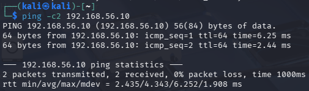

Рисунок 1 — Проверка доступности сервера командой ping

Потери пакетов нулевые, значит сеть работает. Дальше смотрим порт SSH.

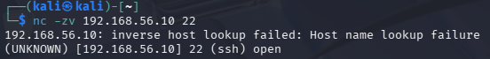

Рисунок 2 — Проверка открытого порта 22 (SSH)

Порт отвечает open — сервер готов принимать подключения, можно переходить к атаке.

---

## Шаг 2. Проведение атаки

Атака выполняется утилитой hydra. Ей передаётся имя пользователя, небольшой
список паролей и адрес сервера. Список намеренно маленький (20 паролей) — этого
достаточно, чтобы система зафиксировала перебор, и при этом стенд не захлёбывается
от событий. Список создаётся одной командой в терминале Kali.

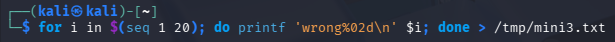

Рисунок 3 — Создание тестового списка из 20 паролей

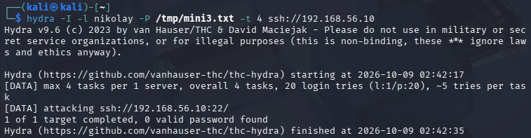

Рисунок 4 — Запуск перебора паролей по SSH

Результат — 0 valid password found, то есть пароль не подобран. Так и было
задумано. Нам интересно не это, а то, что сервер за 18 секунд получил два десятка
неудачных попыток входа с одного адреса.

---

## Шаг 3. Что увидел сервер

Прежде чем смотреть в дашборд, полезно убедиться, что сами попытки дошли до
сервера и попали в системный журнал. В логе /var/log/auth.log видно серию строк
Failed password for nikolay from 192.168.56.102.

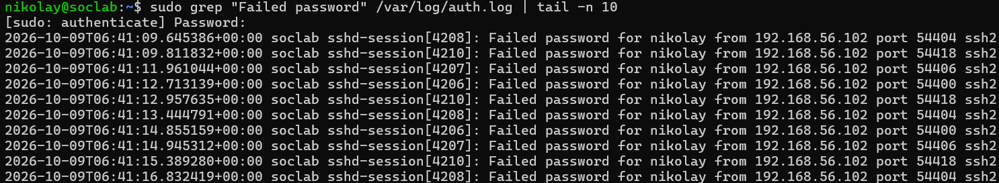

Рисунок 5 — Записи о неудачных входах в системном логе сервера

Все записи идут с адреса Kali и с интервалом буквально в доли секунды. Это и есть
характерная картина перебора — обычный пользователь так часто пароль не вводит.

---

## Шаг 4. Обнаружение в Wazuh

Теперь главное — как на это отреагировал SIEM. В разделе Threat Hunting →
События по серии неудачных входов поднялось сразу несколько правил.

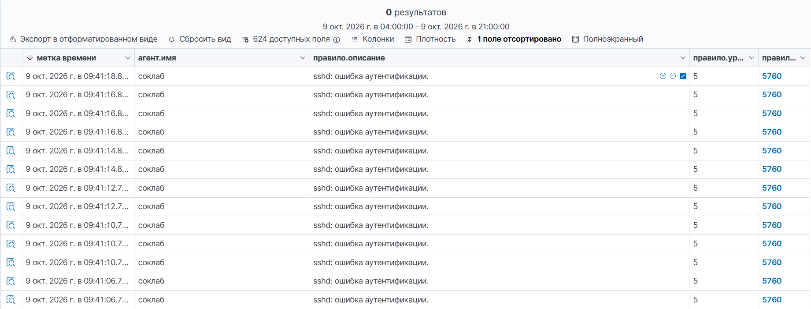

Рисунок 6 — Серия событий «sshd: ошибка аутентификации» (правило 5760)

На рисунке 6 видно, что каждая неудачная попытка превращается в событие правила
5760 «sshd: authentication failed». Таких событий много, и все они укладываются
в несколько секунд. Наглядно всплеск виден и на гистограмме.

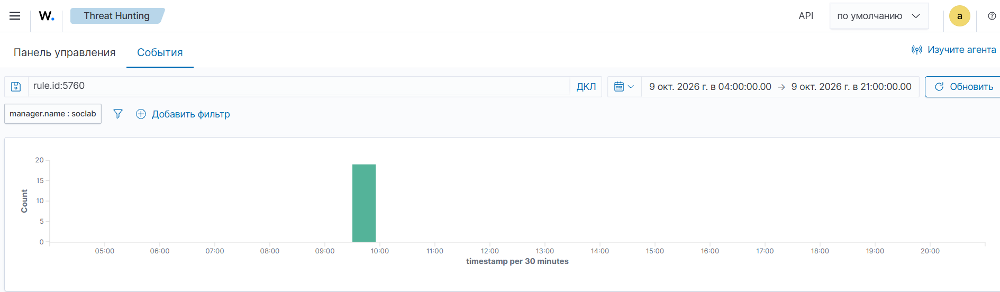

Рисунок 7 — Всплеск событий в момент атаки

Отдельно стоит отметить правило 2502 «User missed the password more than one
time» с уровнем 10. Оно как раз и срабатывает на повторяющиеся неудачи и, по сути,
говорит «кто-то настойчиво перебирает пароль». То есть Wazuh не просто записал
отдельные ошибки, а поднял отдельный алерт о подозрительной активности.

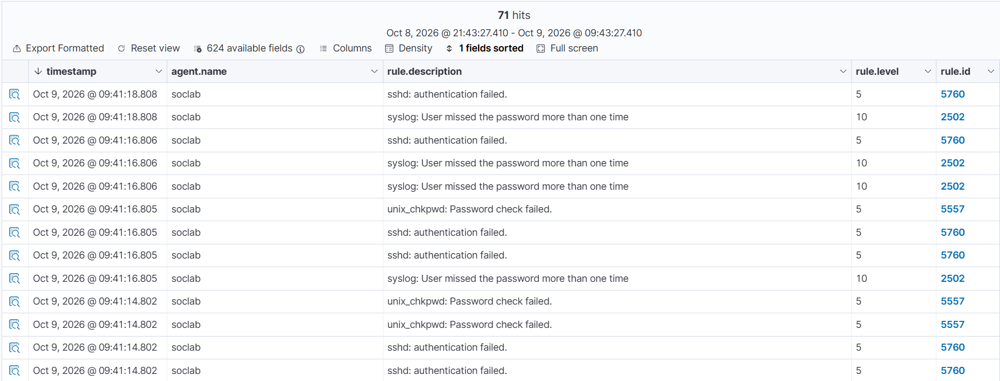

Рисунок 8 — Агрегирующее правило 2502 (уровень 10) о повторных неудачах

Общую картину удобно смотреть на панели Threat Hunting → Dashboard: там сразу
видно количество неудачных аутентификаций за период.

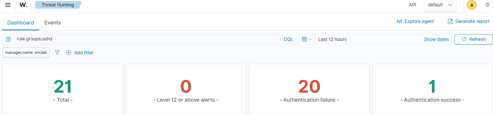

Рисунок 9 — Сводка: количество неудачных попыток аутентификации

Для наглядности сравним панель до и после атаки. До атаки за последние 12 часов
было 23 события, и ни одной неудачной аутентификации.

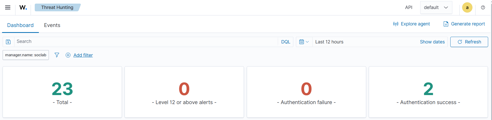

Рисунок 10 — Панель Threat Hunting до атаки (Authentication failure: 0)

После атаки общее число событий выросло до 71, а счётчик неудачных аутентификаций
показывает 48.

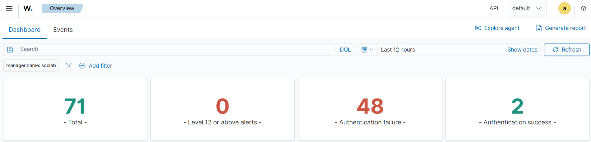

Рисунок 11 — Панель Threat Hunting после атаки (Authentication failure: 48)

---

## Важный нюанс: правило 5712

При подготовке сценария выяснился интересный момент. Известное правило 5712
«sshd: brute force» в этом случае не сработало — его счётчик остался нулевым.

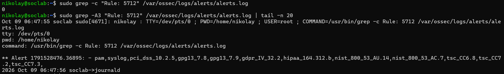

Рисунок 12 — Правило 5712 по существующему пользователю не срабатывает

Дело в том, что 5712 рассчитано на перебор несуществующих пользователей (когда
в логе появляется «Invalid user»). А мы атаковали реального пользователя nikolay,
поэтому сервер пишет «Failed password», и срабатывают другие правила — 5760 и 2502.
Если же атаковать выдуманный логин, которого на сервере нет, то поднимется и 5710,
и 5712. Получается, что брутфорс по существующему и несуществующему пользователю
Wazuh ловит немного разными правилами. Это стоит учитывать при настройке.

---

## Привязка к MITRE ATT&CK

Все сработавшие правила привязаны к технике T1110 (Brute Force) из матрицы
MITRE ATT&CK — это стандартная классификация атак подбором учётных данных.

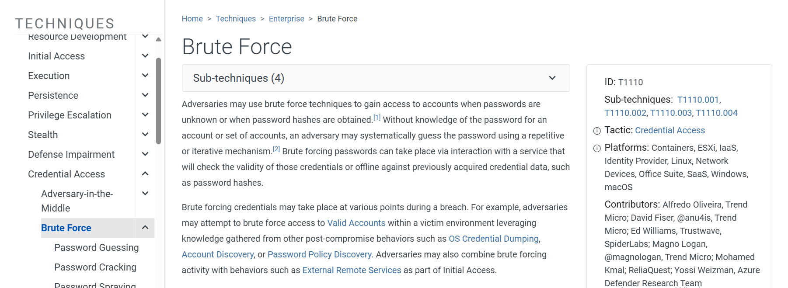

Рисунок 13 — Описание техники T1110 (Brute Force)

---

## Выводы

Сценарий показал полный путь события — от атаки на Kali до алерта в Wazuh. Сервер
корректно зафиксировал серию неудачных входов (правило 5760), а также поднял
отдельный алерт о повторных попытках (правило 2502, уровень 10). Событие
классифицировано по технике MITRE T1110. Таким образом, стенд успешно обнаруживает
атаку подбором пароля по SSH, что и требовалось проверить.
